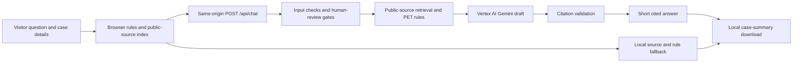

# Architecture

## Answer path

The browser loads `public/data/sources.json`, keeps its transcript and editable case profile in memory, and can compose a deterministic fallback answer. The server imports the same 47-passage public corpus, normalizes PET vocabulary, and ranks evidence with BM25. For use cases, it combines retrieved evidence with the inspectable rules in `public/engine.mjs`. Those rules distinguish goal, input privacy, output privacy, and governance, and can propose layered PETs with counterindications.

The shared `server/http.mjs` boundary accepts a bounded JSON message, intent, case profile, and recent context. It checks request origin and size and applies a best-effort in-memory request limit. The origin check is a browser safeguard, not authentication against arbitrary HTTP clients. `server/rag.mjs` blocks selected legal-permission and risky-release cases before a model call. For other questions with evidence and a configured credential, it sends Vertex AI the question, recent context, structured case facts, rule summary, and selected **public** source summaries. It requests a short structured answer with source IDs.

The server rejects missing, invented, or malformed citations. The browser checks returned source IDs and URLs against its public corpus before display. These checks confirm citation identity and format; they cannot prove that every sentence is substantively correct. The browser uses local retrieval and rule content if the model is unavailable or returns an unusable answer.

## Hosts and deployment status

**Google Cloud Run is the selected public host.** The repository-root `Dockerfile` packages `public/`, `server/`, and `cloud-run/`. The Cloud Run adapter serves static files and `/api/chat` from one origin. It uses the Cloud Run metadata server to obtain an OAuth access token for a dedicated service identity, then calls the project-scoped Vertex AI Gemini endpoint. An administrator should grant that identity a custom role with `aiplatform.endpoints.predict` for Gemini calls. A Gemini API key is not needed for this route. The Cloud Run application is prepared in code but **is not deployed yet**. See [the setup guide](DEPLOY_GOOGLE_CLOUD_RUN.md).

The Cloud Run endpoint is intended to allow public access. It allows 30 valid chat requests per ten minutes across all visitors **per process**, and `cloud-run/budget.mjs` reserves at most 100 paid model calls per UTC day per process. The adapter uses one server-controlled rate key; visitor-supplied forwarding headers cannot raise the limit. Both counters reset on restart and duplicate if instances or revisions overlap. Request and model output sizes are bounded. A maximum instance setting can curb scaling but does not place a hard cap on Vertex AI charges. The browser falls back to public-source answers if the provider is unavailable.

The existing Sites preview uses Vinext and a Cloudflare Worker. Its `/api/chat` route requires a Sites authenticated-user identity. It has no access to the GitHub Environment key, so the preview uses the browser's public-source fallback. An additional Cloudflare public-deployment implementation remains in the repository but is **not** the selected host.

## Privacy and content boundary

The corpus contains short draft summaries linked to public MDI, NIST, ICO, U.S. Department of Education, GOV.UK, and peer-reviewed sources. Their metadata has been checked, but each summary still needs a recorded expert check against its cited source. Public reports linked by MDI are represented by page-specific summaries; report files, internal notes, partner contacts, and datasets are not shipped. See [the source policy](CONTENT_POLICY.md).

Visitor text is rendered as text rather than HTML. The app does not intentionally store a server-side transcript or use analytics, and **Download** creates a local file. Gemini-enabled requests pass through the host and Google; this code alone cannot guarantee their logging or retention practices. Visitors should provide hypothetical details and avoid protected or confidential information.

The engine does not infer permission under FERPA or other laws from a PET choice. A trusted research environment and a trusted execution environment are distinct. Synthetic data are not presumed private, and a hash is not presumed anonymous. Some high-risk cases are intercepted by coded review gates; those gates are not a complete privacy or legal review.

## Evaluation and next steps

`npm run check` validates source metadata and rule citation IDs, tests decision and endpoint behavior, and checks retrieval on ten synthetic questions. The corpus is incomplete and has not had source-by-source expert review. Tests cover coded scenarios and failure handling, not expert recommendation quality or end-to-end privacy.

Before agency-facing use, prepare authorized and de-identified case records; have PET specialists label primary and complementary methods, counterindications, and missing facts; freeze an expert test set; and measure recommendation quality, unsupported claims, abstention, privacy risk, and utility. Establish source review owners, update cadence, version history, and release approval. The current Gemini integration drafts wording from public evidence; it is not trained on private materials and does not replace this expert evaluation.
