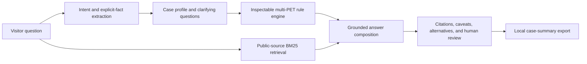

# Architecture

## Current public implementation

Everything runs in the browser from static files. The visitor's text is not sent to an application endpoint. The source index is loaded from `dist/data/sources.json`; each chunk has an ID, original summary, title, URL, publisher, publication year when known, tags, jurisdiction, source role, and review date. Public report passages also carry a document title, section, page, and public MDI landing page. Normalized PET vocabulary and BM25 rank chunks. The response composer displays retrieved summaries and direct source links for information questions. Architecture rules cite selected passages that support each PET claim.

The deterministic engine separates **goal**, **input privacy**, **output privacy**, and **governance**. It can propose more than one PET: for example, linkage plus private computation plus an aggregate-output control. It also records when a method is poorly matched to a case, such as exact hashing alone for approximate matching. It asks for missing facts in the conversation instead of filling them in. Visitors can review and correct the inferred case details within the chat.

Unknown or denied authority for protected records stops the technical recommendation. Proposed direct-identifier or protected row-level releases trigger human review. Legal questions route to jurisdiction-relevant guidance and human review. New use cases clear prior case facts. Every architecture remains exploratory until experts verify legal authority, the threat model, implementation feasibility, disclosure risk, utility, and source currency.

## Content and safety boundary

The deployed index contains only reviewed, publicly accessible resources. Project notes and data inventories inform the design but are excluded from retrieval and the public repository. Public pilot reports linked from MDI are summarized in short original passages; their files are not shipped. No personally identifiable information is needed to use the interface. Untrusted visitor text is rendered as text, never as HTML.

The app does not infer permission under FERPA or other laws from a PET choice. PETs can reduce a risk; legal authority and governance must be established separately. “Trusted research environment” (governed access) and “trusted execution environment” (hardware isolation) are separate categories. Synthetic data are not presumed private, and a hash is not presumed anonymous.

## Evaluation today

`npm run check` validates source metadata and rule citations, runs decision and retrieval tests, and checks recall@5 on ten synthetic questions. The repository includes scenarios for fuzzy linkage, authority escalation, direct-identifier release, report-specific retrieval, and unrelated queries. This is regression coverage, not expert validation. The 47-passage source set is manually curated and incomplete; a production knowledge program needs review owners, update cadence, version history, and source-level approvals.

## Path to the intended expert system

1. **Private case processing.** In a controlled environment, turn authorized meeting notes into multiple case-level needs records. Remove unnecessary personal and partner detail. Record provenance and consent for each use.
2. **Expert annotation.** Let PET specialists assign primary and complementary methods, counterindications, missing facts, and an ideal architecture. Use at least two reviewers for ambiguous cases and adjudicate disagreements.
3. **Evaluation before model selection.** Freeze a test set of expert cases and score recommendation precision, omitted caveats, unsafe overconfidence, citation support, and abstention. Include multi-PET architectures and source-currency failures.
4. **Private model integration.** A provider interface can replace only the wording and extraction layer at first. Keep recommendation rules, citations, and escalation independently checkable. Fine-tune an appropriately licensed open model only after enough expert-labeled cases exist and privacy controls are approved.
5. **Feedback and release.** Route exported cases and proposed answers through human review, add approved cases to the evaluation set, and release changes only after regression and domain review.

The public static site is a team demonstration and knowledge tool. Private annotations, model training, automatic retraining, and protected-data ingestion are separate work because they require governance, ground truth, compute, and expert approval that are not present in the public materials.
