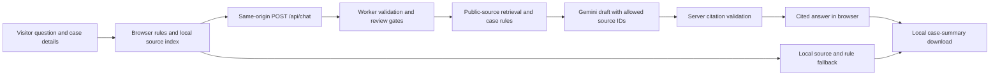

# Architecture

## Current implementation

Vinext serves the page and `/api/chat` from a Cloudflare Worker on Sites. The browser loads `public/data/sources.json`, keeps its transcript and editable case profile in memory, and can compose a deterministic fallback answer. The server imports the same 47-passage public corpus, normalizes PET vocabulary, and ranks evidence with BM25. For use cases, it combines retrieved evidence with the inspectable rules in `public/engine.mjs`; those rules distinguish goal, input privacy, output privacy, and governance, and can propose layered PETs plus counterindications.

The endpoint accepts a bounded JSON message, intent, case profile, and recent context. In production it requires a Sites authenticated-user identity. It checks request origin and size, limits requests per identity in Worker memory, and returns uncached JSON. The server blocks selected legal-permission and risky-release cases before a model call. For other requests with evidence and a configured key, it sends Gemini the question, recent context, structured case facts, rule summary, and selected **public** source summaries. The key stays in the Worker binding. The request sets `store: false` and asks for a short structured response citing only offered source IDs.

The server rejects missing, invented, or malformed citations; the browser checks returned source IDs and URLs against its public corpus before display. This checks citation identity and format, not whether every sentence is substantively correct. The browser uses local retrieval and rule content if the model is missing, fails, or returns an unusable answer. Answers remain exploratory until experts verify authority, threat model, implementation feasibility, disclosure risk, utility, and source currency.

## Privacy and content boundary

The corpus contains short original summaries of reviewed, public MDI, NIST, ICO, U.S. Department of Education, GOV.UK, and peer-reviewed sources. Public reports linked by MDI are represented by page-specific summaries; report files, internal notes, partner contacts, and datasets are not shipped. See [the source policy](CONTENT_POLICY.md).

Visitor text is rendered as text rather than HTML. The app does not intentionally store a server-side transcript or use analytics, and **Download** creates a local file. However, Gemini-enabled requests pass through the hosting platform and Google; this code alone cannot guarantee their logging or retention practices. Visitors should provide hypothetical details and avoid protected or confidential information.

The engine does not infer permission under FERPA or other laws from a PET choice. A trusted research environment and a trusted execution environment are distinct. Synthetic data are not presumed private, and a hash is not presumed anonymous. Some high-risk cases are intercepted by coded review gates; those gates are not a complete privacy or legal review.

## Evaluation and next steps

`npm run check` validates source metadata and rule citations, tests decision and endpoint behavior, and checks retrieval on ten synthetic questions. The corpus is manually curated and incomplete. Tests cover coded scenarios and failure handling, not expert recommendation quality or end-to-end privacy.

Before agency-facing use, prepare authorized and de-identified case records; have PET specialists label primary and complementary methods, counterindications, and missing facts; freeze an expert test set; and measure recommendation quality, unsupported claims, abstention, privacy risk, and utility. Establish source review owners, update cadence, version history, and release approval. The current Gemini integration drafts wording from public evidence; it is not trained on private materials and does not replace this expert evaluation.
