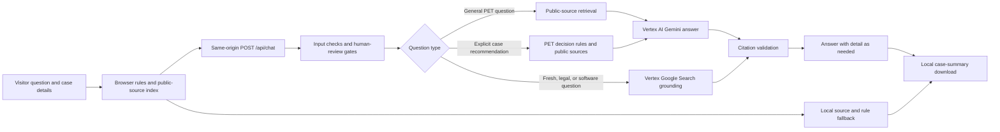

# Architecture

## Answer path

The browser loads `public/data/sources.json`, saves chat transcripts and editable case profiles in browser storage, and can compose a deterministic fallback answer. New assistant answers save a safe structure of their visible text and links, so reloading restores inline citations, emphasis, and punctuation in place. Model answers also retain their original cited segments and source IDs. Older saved chats contain flattened text and cannot recover punctuation that was already lost. Saved chats can be reopened on the same browser profile and are not synchronized across devices. The server imports the same 53-passage public corpus, normalizes PET vocabulary, and ranks evidence with BM25. General PET questions stay in Q&A mode even when they mention a possible project or a PET. Only an explicit request to choose an approach enters the case recommendation flow; that flow asks for missing facts when necessary. A beginner question favors the MDI resource hub and basic PET explanations over a keyword-matched pilot. Relevant pages in [MDI's PET resource hub](https://mdi.georgetown.edu/pets/) receive a small ranking boost; this is not an accuracy or authority claim. For sufficiently described recommendation cases, `public/related-cases.mjs` selects at most one short public MDI pilot note when the project constraints match. The note has its own source link and appears only once per case in the saved conversation. The main answer remains focused on the visitor's needs. Synthetic-data work maps to Nebraska NSWERS, while NYSED maps to clean-room linkage only. For explicit recommendations, the app combines evidence with the inspectable rules in `public/engine.mjs`. Those rules distinguish goal, input privacy, output privacy, and governance, and can propose layered PETs with counterindications.

The shared `server/http.mjs` boundary accepts a bounded JSON message, intent, case profile, and recent context. It checks request origin and size and applies a best-effort in-memory request limit. The origin check is a browser safeguard, not authentication against arbitrary HTTP clients. `server/rag.mjs` blocks selected case-specific legal-permission and risky-release requests before a model call. General legal questions receive sourced explanations; they do not ask the model to certify a particular project. For locally covered PET questions, it sends Vertex AI the question, up to eight recent turns, and selected **public** source summaries, and requires source IDs in the answer. Case facts and decision rules are included only for explicit recommendation requests. Ordinary chat also goes to Gemini with no citations. Software comparisons, freshness questions, general legislation questions, missing definitions, and PET questions poorly covered by the corpus use one Vertex call with Google Search grounding. If a valid local answer says its sources cannot answer a public question, a second budgeted web-grounded call can replace it. The server accepts only answer text tied to valid public HTTPS links in grounding metadata; the browser displays those links and Google's required search suggestion. A public web follow-up can include the prior assistant reply as context, never as evidence. This dynamic web route does not add pages to the static corpus or establish expert review. Pattern-based routing checks the question and earlier topic for apparent confidential case details before Search but cannot guarantee that visitor text is safe. Confidential NYSED meeting notes remain local and do not enter either path.

Short follow-ups preserve the original topic and recent answer. “Elaborate” expands a pilot only when the preceding answer actually named one; otherwise it stays with the prior guidance. A resource request after a named pilot favors its public report. A conservative PET vocabulary uses the vendored MIT-licensed `fastest-levenshtein` library to correct close term typos before retrieval and web research. A definition question uses the local corpus only when a relevant passage is explicitly tagged as a definition; a pilot or risk note mentioning the term is insufficient, so the server asks Search instead. The server rejects missing, invented, or malformed local citations. The browser checks local source IDs and URLs against its public corpus and separately validates dynamically grounded web links before display. Inline local citations use the source owner and report page rather than treating our note headings as page titles. The “Why this answer” panel groups notes sharing a URL under one original-page link and labels paraphrases as our summaries; neither citation route proves every sentence correct. The browser uses local retrieval and rule content if the model is unavailable or returns an unusable answer.

## Hosts and deployment status

**Google Cloud Run with IAP is the selected private host.** The repository-root `Dockerfile` packages `public/`, `server/`, and `cloud-run/`. The Cloud Run adapter serves static files and `/api/chat` from one origin. IAP requires a Google sign-in. The app uses the Cloud Run metadata server to obtain an OAuth access token for a dedicated service identity, then calls the project-scoped Vertex AI Gemini endpoint. That identity has a narrow custom role with `aiplatform.endpoints.predict`; live cited answers confirm the path works. A Gemini API key is not needed for this route. One Georgetown user has accessed the private service, while the full invite policy still needs administrator confirmation. See [the setup guide](DEPLOY_GOOGLE_CLOUD_RUN.md).

The Cloud Run endpoint is intended for selected IAP-authorized users. It allows 60 valid chat requests per ten minutes across all visitors **per process**, and `cloud-run/budget.mjs` reserves at most 250 paid model calls, including at most 75 web-grounded calls, per UTC day per process. The adapter uses one server-controlled rate key; visitor-supplied forwarding headers cannot raise the limit. Counters reset on restart and duplicate if instances or revisions overlap. Request and model output sizes are bounded. A maximum instance setting can curb scaling but does not place a hard cap on Vertex AI charges. The browser falls back to intake questions or public-source answers if the provider is unavailable.

The existing Sites preview uses Vinext and a Cloudflare Worker. Its `/api/chat` route requires a Sites authenticated-user identity. It has no access to the GitHub Environment key, so the preview uses the browser's public-source fallback. An additional Cloudflare public-deployment implementation remains in the repository but is **not** the selected host.

## Privacy and content boundary

The corpus contains short draft summaries linked to public MDI, NIST, ICO, U.S. Department of Education, GOV.UK, and peer-reviewed sources. Their metadata and a [subset of source claims](SOURCE_AUDIT.md) have been checked, but each summary still needs a recorded expert check against its cited source. Public reports linked by MDI are represented by page-specific summaries; report files, internal notes, partner contacts, and datasets are not shipped. See [the source policy](CONTENT_POLICY.md).

Visitor text is rendered as text rather than HTML. The app does not intentionally store a server-side transcript or use analytics. Browser-local saved chats can be viewed by someone using the same browser profile; **Download** creates a local file. Gemini-enabled requests pass through the host and Google; this code alone cannot guarantee their logging or retention practices. Visitors should provide hypothetical details and avoid protected or confidential information.

The engine does not infer permission under FERPA or other laws from a PET choice. A trusted research environment and a trusted execution environment are distinct. Synthetic data are not presumed private, and a hash is not presumed anonymous. Some high-risk cases are intercepted by coded review gates; those gates are not a complete privacy or legal review.

## Evaluation and next steps

`npm run check` validates source metadata and rule citation IDs, tests decision and endpoint behavior, and checks retrieval on 19 synthetic questions. `data/persona_scenarios.json` adds hypothetical beginner, Arkansas, Nebraska, D.C., NYSED, legal, software, and recommendation cases for bounded live Vertex review; `scripts/evaluate-personas.mjs` writes results and estimated usage into ignored local files. The corpus is incomplete and has not had source-by-source expert review. Tests cover coded scenarios and failure handling, not expert recommendation quality or end-to-end privacy.

Before agency-facing use, prepare authorized and de-identified case records; have PET specialists label primary and complementary methods, counterindications, and missing facts; freeze an expert test set; and measure recommendation quality, unsupported claims, abstention, privacy risk, and utility. Establish source review owners, update cadence, version history, and release approval. The current Gemini integration drafts cited PET answers from public evidence and handles ordinary chat. It does not train Gemini or replace this expert evaluation.
